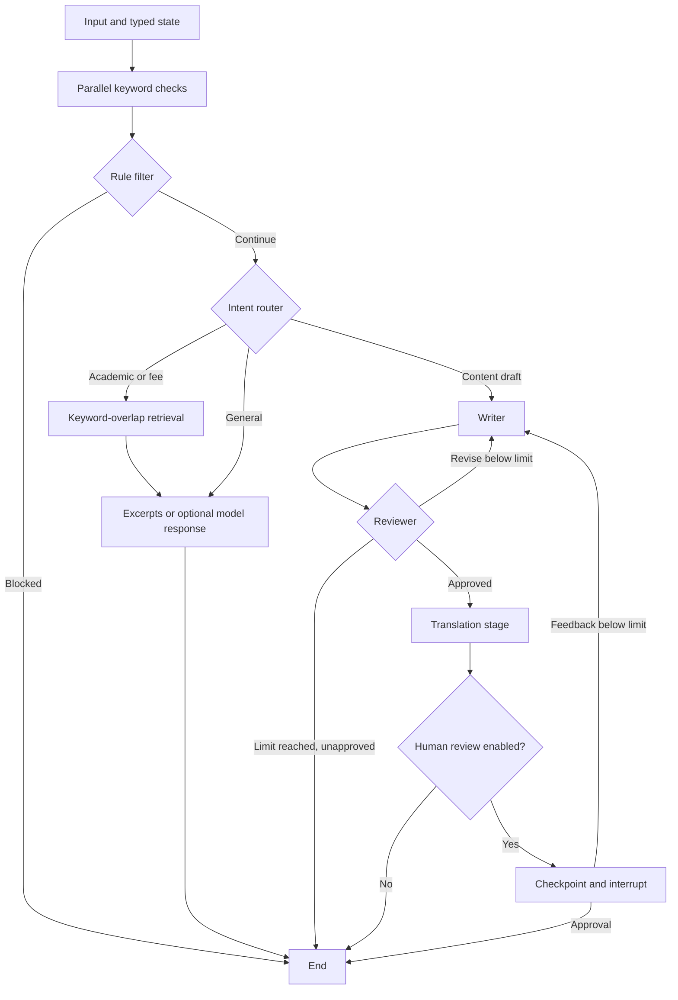

# LangGraph agentic workflow lab

An educational Python project by **Abhi Kumar Gurjar**, prepared from my Desktop Agentic AI project. It combines parallel rule checks, conditional document retrieval, bounded drafting/review loops, sequential transformation, and optional human approval in a single LangGraph graph.


## Why this project

The project makes agent orchestration inspectable: typed shared state, reducers, conditional edges, a retry limit, and checkpointed interruption/resumption. It is a portfolio demonstration of workflow engineering, not a claim of autonomous production deployment or measured model quality.

## Quick start: offline

```bash
git clone https://github.com/abhigurjar101/langgraph-agentic-workflows.git
cd langgraph-agentic-workflows
python3 -m venv .venv
source .venv/bin/activate
pip install -r requirements.txt
python demo.py
python -m unittest discover -s tests -v
streamlit run app.py
```

Offline mode is the default. The demo retrieves an explicitly synthetic attendance statement. Drafting/review in this mode is simulated; translation is labeled as unperformed. No key, model download or hosted inference is required. Tests explicitly select offline mode and use mocked model responses where needed.

## Workflow architecture



The “agents” here are workflow nodes, some deterministic and some optionally model-backed. They are not independently trained models. Three rule checks merge their scores through a reducer. Retrieval is lexical overlap over two small text fixtures, not embedding-based semantic search. MemorySaver checkpoints are in process and do not survive a server restart.

## Optional live model

```bash
pip install -r requirements-live.txt
export AGENT_MODE=live
export NVIDIA_API_KEY='your-own-key'
export NVIDIA_MODEL='a-model-available-in-your-account'
python demo.py
```

Select a model available to your account. `llm_factory.py` uses an OpenAI-compatible client pointed at NVIDIA's API. Remote requests send prompts and retrieved context to that service and may incur charges. `.env.example` documents the variables; the app does not automatically load a credentials file. Live inference, cost, latency, answer quality and UI behavior have not been verified as part of this publication.

## Human approval example

```python
from langgraph.types import Command
from demo import initial_state
from unified_agent import build_master_agent

graph = build_master_agent(enable_hitl=True)
config = {"configurable": {"thread_id": "review-demo"}}
paused = graph.invoke(initial_state("Write a post about graph workflows"), config=config)
assert paused.get("__interrupt__")
finished = graph.invoke(Command(resume="approved"), config=config)
```

The lightweight UI runs the graph without human review; use the Python API above for the interrupt path.

## Tested behavior

Seven regression tests cover both retrieval routes, preservation of parallel scores, unmatched evidence, early rule rejection, retry limits, failed/negative model-review handling, and human interrupt/resume. CI runs the same suite. These are software correctness checks, not a benchmark of safety, answer groundedness, or general task success.

The portfolio copy fixes approval parsing so “NOT APPROVED” cannot match “APPROVED,” prevents failed reviews from passing, and ends unapproved work at the retry limit. Institution-specific canned answers and cached PDFs were replaced with clearly synthetic evidence.

## Limitations and next steps

Keyword filtering has false positives and misses many harmful inputs; its numbers are heuristic flags, not calibrated risk probabilities. Document retrieval does not implement embeddings, reranking or a persistent index. The app has no authentication, persistent checkpoint store, tracing dashboard, cost budget or load test. Next steps are a labeled retrieval/task evaluation set, real tool integrations with permission boundaries, durable checkpoints, and measured live-model evaluation.

## Repository map

| Path | Purpose |
|---|---|
| `unified_agent.py` | State, nodes, routing, reducer and graph assembly |
| `llm_factory.py` | Explicit offline/live model selection |
| `demo.py` | Initial state and CLI demo |
| `app.py` | Streamlit interface with session-scoped graph state |
| `data/` | Two invented, labeled text fixtures |
| `tests/` | Seven offline regression tests |
| `ATTRIBUTION.md` | Original Desktop source and curriculum attribution |

Original curriculum credit is preserved in [ATTRIBUTION.md](ATTRIBUTION.md). No course slides, employer logos, local keys or institutional documents are included.

[LinkedIn](https://www.linkedin.com/in/abhigurjar) · [GitHub](https://github.com/abhigurjar101)
